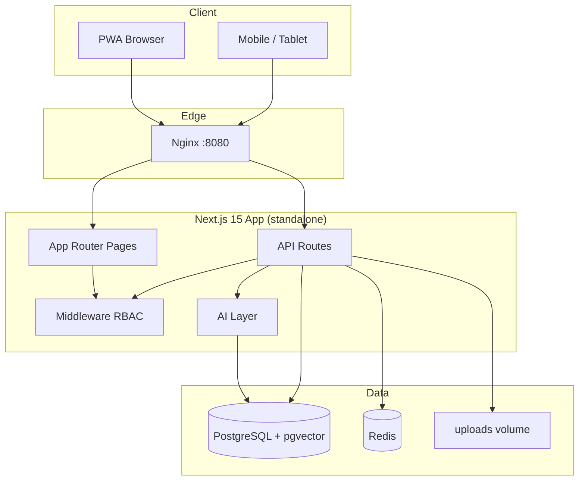
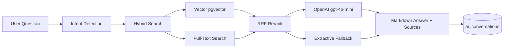
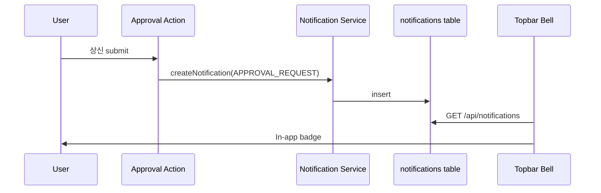

# 아키텍처 다이어그램

> intranet-part1 — Phase 4 상품화 기준 (2025-06)

## 시스템 개요



## AI / RAG 파이프라인



## 알림 흐름



## Phase 4 추가 컴포넌트

| 영역 | 신규/개선 |
|------|-----------|
| UI | Sonner toast, Recharts, PWA manifest+SW, a11y |
| AI | Hybrid search, conversation memory, markdown chat |
| 기능 | notifications, user preferences, activity log, i18n, help |
| 테스트 | Playwright E2E, load-test.mjs |
| 문서 | USER/ADMIN/API manual |

## 디렉터리 구조

```
src/
├── app/              # Routes + API
├── features/         # Domain modules
├── components/       # UI + layout
├── lib/              # infra (ai, security, redis…)
├── i18n/             # ko/en messages
└── config/           # navigation
prisma/
├── schema.prisma
└── migrations/
```

---

배포: `DEPLOY.md` · 사용자: `USER_MANUAL.md` · 관리: `ADMIN_MANUAL.md`
