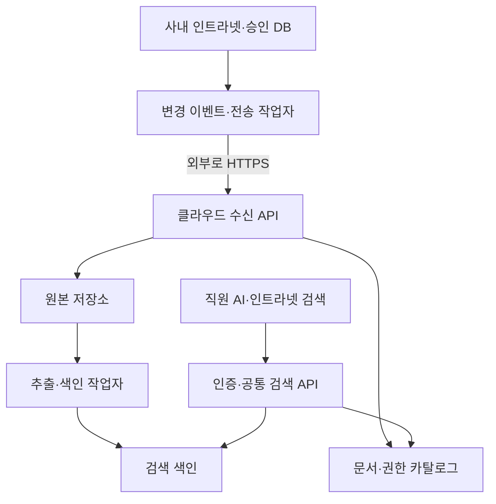

# French Maison 인트라넷·클라우드·RAG 연동 설계 v0.1

작성일: 2026-10-02 (Asia/Seoul)  
PM: 사용자 / 기술·전략 설계: Mr. Sun  
상태: 상위 구성 승인, 아래 상세 설계는 구현 전 제안. 클라우드 배포·운영 코드 변경 없음.

## 1. 승인된 결정과 검토 범위

기존 인트라넷은 업무·승인의 기준 창구로 유지한다. 클라우드는 원본 보관과 공통 검색 기능을 담당한다. 첫 대상은 영업·디자인이며 관리·ERP는 후속 단계다. Microsoft 365 가입과 특정 공급자 선택은 미확정이다.

코드 검토 기준은 teneyes25/intranet-part1의 커밋 d9884846099312b23232c8b84023a8ec01f85d99이다. 사용자가 전달한 Cloud Agent 진단상 이 체크아웃에는 미커밋 변경과 실행 중인 인트라넷이 없다. 사무실 PC 192.168.0.16:8080의 운영 브랜치·커밋·실행 방식은 미확인이다. 이 문서는 사무실 운영 버전의 보안 진단이나 배포 검증 결과가 아니다.

## 2. 코드에서 확인한 재사용 기반과 차이

| 파일 | 확인한 구현 | 보완 설계 |
|---|---|---|
| src/lib/uploads.ts | 로컬 uploads 저장. 이미지에 회전·최대 폭 1920 조정, JPEG/WebP 품질 82 적용 | 디자인 원본 바이트를 먼저 보존하고 미리보기는 파생 파일로 분리. 기존 파일을 원본이라고 소급 단정하지 않음 |
| src/lib/ai/ingest.ts | 게시글 제목·HTML 본문을 분할해 색인. 기존 조각 삭제 후 임베딩 생성 | 첨부문서 추출 경로 추가. 신규 버전 생성 성공 후 원자적으로 검색 버전 교체 |
| src/lib/ai/vector-store.ts | 벡터 검색 조건은 sourceType. 사용자·부서·승인 상태 조건 없음 | 검색 후보 단계에서 조직·문서 권한·유효 승인 버전 조건 적용 |
| src/lib/ai/hybrid-search.ts | 모든 게시판 목록으로 본문 검색, 벡터 결과와 결합 | 키워드·벡터 경로 모두 동일 권한 필터 적용 |
| src/lib/ai/chat.ts | 답변 함수에 사용자 인자 없음. 자료 인용 프롬프트와 발췌 fallback 존재 | 인증된 사용자 문맥 전달, 출처 버전·위치·동기화 시점 반환. 뉴스 및 fallback도 권한 검사 |

위 내용은 해당 함수의 정적 검토 결과다. API 라우트·전체 호출자·실제 배포 설정은 추가 검토 대상이며, 실제 권한 누출이 발생했다는 의미가 아니다. 기존 검색 구현을 외부 에이전트에 그대로 공개하지 않는다.

## 3. 논리 구성

인트라넷: 작성·검토·승인·문서 권한 변경의 기준 시스템.  
클라우드 원본 저장소: 확인된 버전별 바이트 보관. 직원 직접 수정은 초기 범위에서 제외.  
클라우드 카탈로그: 인트라넷에서 수신한 승인·권한의 복제본과 검색 활성 버전 관리.  
검색 색인: 원본에서 다시 만들 수 있는 파생 데이터. 업무 원장으로 사용하지 않음.  
공통 API: 사용자 인증과 문서 권한을 검사하고 근거 조각을 제공. 특정 AI 모델에 종속되지 않음.

사무실 작업자가 이벤트 전송과 상태 조회를 시작한다. 클라우드에서 사내 PC에 직접 접속하는 공개 포트를 요구하지 않는다. 초기에는 기존 코드 기반을 활용하는 클라우드 서비스와 별도 작업자로 구성하고, 많은 마이크로서비스로 나누지 않는다. 공급자·제품·비용은 이후 비교 결정한다.

## 4. 데이터 계약

| 엔터티 | 필수 정보 |
|---|---|
| Document | tenant_id, document_id, 제목, 부서, 담당자, source_system, source_id, 승인 버전, 상태 |
| DocumentVersion | version_id, document_id, 파일명, MIME, 크기, SHA-256, storage_object_id, 승인자·승인일, 유효기간 |
| DocumentACL | 문서/그룹/사용자 허용 규칙, acl_revision, 권한 갱신 시점 |
| Chunk | chunk_id, version_id, 본문, 페이지/슬라이드/시트·셀 위치, 추출기 버전, 임베딩 모델·차원 |
| SyncEvent | event_id, document_id, 문서별 sequence, event_type, version_id, acl_revision, 발생 시각 |
| SyncJob | event_id, 상태, 시도 횟수, 다음 재시도 시각, 오류 분류, 처리 완료 시각 |

같은 파일명은 같은 문서라는 뜻이 아니다. 문서 ID는 이름 변경·폴더 이동에도 유지한다. tenant_id는 서버의 인증 문맥에서 정하고 사용자 요청 값을 신뢰하지 않는다. 초기에는 프렌치메종 한 조직만 활성화하며 다른 고객사의 자료 격리는 상용화 테스트로 검증한다.

승인은 특정 version_id와 해시에 묶는다. 승인 이후 파일이 달라지면 새 미승인 버전이다. 승인된 기존 버전은 새 버전 준비 중에도 유지할 수 있지만, 철회·삭제 시에는 즉시 검색 비활성 대상이다.

## 5. 업로드·검색 반영 흐름

1. 인트라넷이 원본을 임시 보관하고 해시·크기·문서 ID를 기록한다.
2. DB 변경과 outbox 이벤트 기록을 같은 트랜잭션으로 처리한다. 파일 저장은 별도이므로 실패 시 고아 파일 정리 작업을 둔다.
3. 전송 작업자가 클라우드 업로드를 시작한다. 서버가 버전·크기·해시를 확인한 뒤 원본 보관 완료로 표시한다.
4. 검토·승인 이벤트를 전송한다. 원본이 도착하지 않은 승인 이벤트는 대기하며 처리 순서를 추정하지 않는다.
5. 추출·분할·임베딩을 임시 세대에 생성하고 검증한다.
6. 승인·권한·해시가 여전히 일치할 때 검색 활성 버전을 원자적으로 전환한다. 늦게 완료된 구버전 작업은 활성화하지 않는다.
7. 인트라넷은 처리 상태를 조회해 직원에게 표시한다.

업무 상태는 DRAFT / IN_REVIEW / APPROVED / REVOKED / ARCHIVED로, 처리 상태는 PENDING_UPLOAD / STORED / PROCESSING / READY / FAILED로 분리한다. 화면에는 접수 완료·원본 보관 완료·검색 반영 완료·처리 실패를 구별해 보여준다.

중복 이벤트는 event_id로 무해하게 처리한다. 문서별 sequence로 역순 이벤트를 거부하거나 재동기화를 요청한다. 네트워크 실패는 지수 백오프와 재시도, 반복 실패는 별도 실패 대기열로 보낸다. 정기 대조 작업으로 이벤트 누락·저장소 불일치를 복구한다.

## 6. 인증·권한·오프라인 정책

직원 신원은 클라우드 인증 시스템과 인트라넷 사용자 ID를 명시적으로 매핑한다. 중앙 OIDC 공급자 연결을 상세 설계 후보로 두며, 현재 NextAuth 세션이 외부 에이전트 인증까지 제공한다고 가정하지 않는다. 최초 연결 시 관리자 검증을 거친다. 에이전트 연결 방식은 제품별 실제 지원 확인 후 선택한다.

동기화 작업자용 서비스 자격증명은 지정 조직의 원본·이벤트 전송만 허용한다. 직원용 검색 권한을 대신하지 않는다. 외부 에이전트에는 짧은 수명의 사용자 토큰과 read-only 검색 권한을 준다. 문서 권한은 영업·디자인·공통자료 그룹으로 시작하며 대리점 공개는 별도 지정한다.

권한 검사는 키워드·벡터 검색, 발췌, 답변 생성, 파일 다운로드, 캐시, 대화 이력 재사용 모두에 적용한다. 문서 내용은 명령이 아닌 데이터로 취급한다. 기존 대화에 포함된 자료도 재사용 시 현재 권한을 검사한다. 이미 직원이나 외부 에이전트가 내려받은 사본을 소급 회수할 수 있다고 보장하지 않는다.

중요한 오프라인 한계: 인트라넷에서 발생한 철회가 클라우드에 전송되지 않으면 클라우드는 이를 즉시 알 수 없다. 따라서 'PC가 꺼져도 모든 자료를 계속 검색'과 '모든 철회가 즉시 반영'을 동시에 보장하지 않는다.

초기 제안은 제한 자료에 5분의 권한 동기화 유효기간을 두고, 그 기간을 넘으면 검색을 차단하는 것이다. 회사 공통 배포자료만 명시적으로 오프라인 검색 허용 대상으로 지정한다. 이 5분은 구현·시험용 제안값이며 SLA 확정이 아니다. 비상 계정 차단·전체 검색 중단은 클라우드 관리자 기능으로 제공한다. 동기화 정상화 시 재대조 후 검색을 재개한다.

## 7. 공통 API 초안 — 신규 제안, 미구현

| API | 호출자 | 계약 |
|---|---|---|
| POST /knowledge/v1/uploads | 동기화 작업자 | 문서·버전·해시로 업로드 세션 생성 |
| POST /knowledge/v1/uploads/{id}/complete | 동기화 작업자 | 저장 확인 후 STORED 처리 |
| POST /knowledge/v1/events | 동기화 작업자 | 승인·권한·철회 이벤트의 멱등 접수 |
| GET /knowledge/v1/jobs/{id} | 동기화 작업자 | 처리 상태·실패 사유 조회 |
| POST /knowledge/v1/search | 인증된 직원·에이전트 | query, 선택 필터, 최대 결과 수. 서버가 권한을 강제 |
| GET /knowledge/v1/documents/{id}/versions/{version}/content | 인증된 직원 | 재인가 후 원본 또는 제한 수명 다운로드 제공 |

검색 응답 필드: request_id, results[{document_id, version_id, chunk_id, title, excerpt, locator, source_url, approved_at, indexed_at}], last_sync_at, policy_revision, warnings.

source_url은 공개 저장소 URL 대신 인증을 요구하는 근거 조회 URL이다. 현재 사내 상대경로만 반환하면 외부 에이전트가 출처를 열 수 없으므로 클라우드 근거 조회를 제공한다. 자료 부족은 빈 결과와 사유로 반환하며 가격·규격을 생성해 보충하지 않는다. API는 근거 제공을 먼저 구현하고, 생성형 답변은 그 위에 선택 기능으로 둔다.

## 8. 문서 형식과 디자인 원본

PDF는 페이지, PPTX는 슬라이드, XLSX는 시트·셀/행, Markdown은 제목 경로를 유지해 추출한다. 표는 열 이름·단위·상품 식별자를 함께 보존한다. 추출 실패·암호화 파일은 FAILED 또는 수동 검토로 표시하고 성공 처리하지 않는다. 이미지 OCR·상품 이미지 매칭은 검증 전 사실로 사용하지 않는다.

디자인 원본은 해시가 동일한 바이트로 저장한다. 미리보기·썸네일·압축본은 별도 파생 자산이다. 과거 uploads 경로에 이미 압축 저장된 이미지는 원촬영본과 같다고 단정하지 않고 재수급 여부를 표시한다. 그림만 있는 상품자료의 소재·가격·효능을 이미지 추론만으로 확정하지 않는다.

## 9. 구현 순서와 통과 조건

| 단계 | 작업 | 완료 기준 |
|---|---|---|
| A | 운영 커밋 대조, API 라우트·호출자 추적, 저장소·인증 제품 선택 | 현행 코드와 변경 지점·비용 산정 근거 확보 |
| B | 별도 개발 환경에 문서/버전/ACL/outbox 및 저장소 인터페이스 구현 | 중복·역순·중단 후 재시도 테스트 통과 |
| C | 원본 보존·문서 추출·세대별 색인·권한 검색 | 아래 수용 테스트 통과 |
| D | 직원 에이전트 하나와 연결, 영업·디자인 파일럿 | 실제 질문 평가 및 권한 경계 확인 |
| E | 제한 배포·관측·복구 검증 | 운영 PC 버전 확인, 백업 복원 검증, 롤백 절차 확보 |

필수 수용 테스트:
- 영업 전용 자료가 디자인 미허용 계정의 검색·다운로드·발췌·캐시에 나타나지 않는다.
- 미승인 파일은 공식 검색에 나오지 않으며, 승인한 정확한 버전만 검색된다.
- v2 처리 실패 시 허용된 v1이 유지되고, 철회된 v1은 유지되지 않는다.
- 중복 이벤트·역순 이벤트·작업자 재시작이 중복 버전이나 구버전 복원을 일으키지 않는다.
- 정상 연결에서 철회 이벤트 적용 후 해당 자료가 검색과 다운로드에서 차단된다.
- 권한 동기화 유효기간이 지나면 제한 자료 검색이 차단된다.
- PDF/PPTX/XLSX 근거 위치를 원본과 대조한다. 숫자·단위·상품명을 확인한다.
- 디자인 원본 업로드 전후 SHA-256이 동일하다.
- 자료가 없는 질문에 근거 없음이 반환된다.
- 문서 내용에 삽입된 행동 지시로 권한·검색 범위가 변경되지 않는다.

소수의 영업·디자인 샘플로 먼저 검증한다. ERP 실시간 조회와 쓰기 실행은 이 단계에 포함하지 않는다. 성능·비용·가용성 목표는 파일 수·크기·사용자 수 확인 후 산정하며 아직 수치를 약속하지 않는다.

## 10. 역할과 후속 결정

PM: 클라우드 계약, 직원 그룹·승인 담당자, 시범 사용자 지정.  
Mr. Sun: 설계 계약, 변경 범위, 테스트 기준과 결과 검토.  
Cursor/Codex 작업: 동일 문서·커밋을 기준으로 구현하고 변경·검증 결과를 기록. 실제 업무를 배정하거나 실행한 상태는 아님.

운영 PC의 커밋 확인은 배포 전 필요하다. 클라우드 공급자, 중앙 인증, 사용 에이전트, 문서 규모는 미확정이다. 파일 전체 업로드와 Microsoft 365 가입은 공급자 결정 이후 진행한다.

## 검토한 코드 출처

공통 기준 URL: https://github.com/teneyes25/intranet-part1/tree/d9884846099312b23232c8b84023a8ec01f85d99

- [업로드](https://github.com/teneyes25/intranet-part1/blob/d9884846099312b23232c8b84023a8ec01f85d99/src/lib/uploads.ts)
- [색인](https://github.com/teneyes25/intranet-part1/blob/d9884846099312b23232c8b84023a8ec01f85d99/src/lib/ai/ingest.ts)
- [벡터 검색](https://github.com/teneyes25/intranet-part1/blob/d9884846099312b23232c8b84023a8ec01f85d99/src/lib/ai/vector-store.ts)
- [혼합 검색](https://github.com/teneyes25/intranet-part1/blob/d9884846099312b23232c8b84023a8ec01f85d99/src/lib/ai/hybrid-search.ts)
- [답변 생성](https://github.com/teneyes25/intranet-part1/blob/d9884846099312b23232c8b84023a8ec01f85d99/src/lib/ai/chat.ts)

검증 수준: 위 5개 코드 파일과 Git tree의 정적 확인. 프로그램 실행·단위 테스트·클라우드 연결 테스트는 수행하지 않았다. 제안 API와 상태 모델은 구현되지 않았다.
